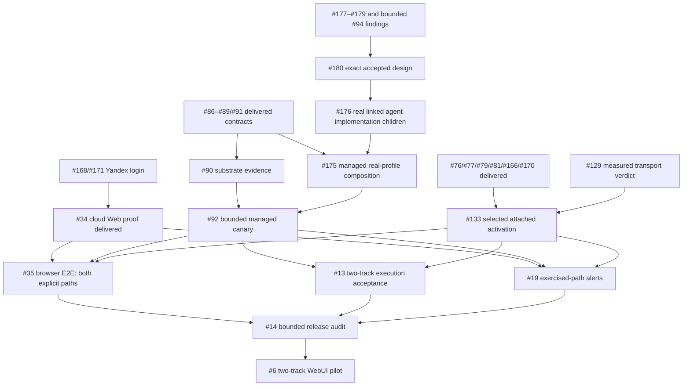
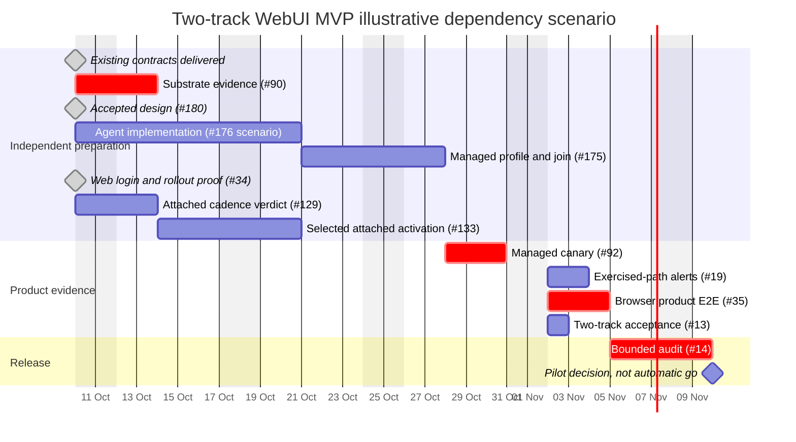

# WebUI-first MVP delivery plan

Status: product-owner-directed two-track scope correction, reconciled 2026-10-11;
managed delivery [#176](https://gitcode.com/urandon/sessionless/issues/176)/
[#175](https://gitcode.com/urandon/sessionless/issues/175), attached delivery
[#72](https://gitcode.com/urandon/sessionless/issues/72).
Scope baseline: accepted `d3eb8fdc069938c05be23212e834a7cc3d82a03e`;
engineering design and implementation-checklist status reconciled against live
PR/issue read-back on 2026-10-10. The
[owner's two-track decision](https://gitcode.com/urandon/sessionless/wiki/MVP-Execution-Tracks-2026-10-10.md)
supersedes both the attached-only scheduling baseline from #167 and the
attached-optional interpretation in the earlier !159 draft, not their delivered
implementation receipts. Planning is not runtime activation.
Owning epics: [#6](https://gitcode.com/urandon/sessionless/issues/6),
[#29](https://gitcode.com/urandon/sessionless/issues/29),
[#13](https://gitcode.com/urandon/sessionless/issues/13).
[#72](https://gitcode.com/urandon/sessionless/issues/72) owns the independently
required attached route. Release joins both paths; one demo does not close MVP.

## Release promise and boundaries

The first pilot signs in through WebUI/Yandex ID and explicitly selects either
one supported ready-made harness on an attached worker or a Sessionless-managed
cloud execution profile. Both paths must create a canonical session, accept
text or bounded image/file input and return useful durable answers/artifacts.
Refresh and re-login retain history. **The managed path requires no user machine,
daemon installation, attached-worker enrollment or personal coding subscription.**
The attached path uses its owner's enrolled host and reviewed harness/resource.
Invitation/audited bootstrap still grants membership; provider login alone does
not create tenant access.

Sessionless owns the append-only Session stream in YDB, immutable large payloads
in Object Storage and admission/attempt/lease/fence/quota/terminal authority.
The serverless control plane routes work to an isolated managed worker; it does
not run AI inline in the Web BFF. Cloud compute is explicitly selected, never a
silent fallback from an attached subscription. Missing, revoked, quota-blocked,
unavailable or ambiguous authority fails visibly and cannot cause duplicate
provider sends, implicit resource switches or unapproved paid-model use.

The bounded [tool-free serverless profile](serverless-harness.md) is reusable
outer-runtime groundwork, not full managed product acceptance. The managed
harness must continue through a bounded model → structured tool → authorized
result → model loop, perform derived compaction without changing canonical
history, expose one useful constrained MCP integration and provide bounded
general web search with durable source-linked answers and WebUI citations.
Documentation lookup alone does not satisfy general search. Arbitrary shell,
model-generated code execution, full-page fetch/browser, generalized plugins,
memory and subagents remain outside this minimum.

One ready-made attached harness suffices; #133 selects Codex as the attached
activation candidate. Other harnesses are not implicit alternatives: changing
the selected route requires an explicitly reviewed bounded task and acceptance
mapping. Pi-specific work was retired under [#213](https://gitcode.com/urandon/sessionless/issues/213);
[#203](https://gitcode.com/urandon/sessionless/issues/203) was cancelled and is
not delivered. Historical code is linked from the
[retirement record](development.md#retired-pi-experiment-record-historical-only).
Native cloud coding-agent processes remain disabled until their own evidence
passes. Shared harness contracts may be reused on user hosts with different
platform launch artifacts, not one binary that runs unchanged on macOS and Linux.

The [shared external harness boundary design](design/external-harness-boundary.md)
under [#215](https://gitcode.com/urandon/sessionless/issues/215) specifies the
conditional external companion and native-container seam. It preserves the
existing network-none profile and the independent managed Go loop; a design or
container image is not evidence of native egress/credential eligibility.

### Cheap/free model and input policy

The local demo must support an **already running, owner-supplied inference
endpoint without paid OpenRouter usage**. [#212](https://gitcode.com/urandon/sessionless/issues/212)
owns the bounded design delta, shared OpenAI-compatible HTTP provider path and
local-development recipe. The owner starts the model server; Sessionless
connects using explicit trusted endpoint/model/protocol/authentication settings,
including no authentication where the local profile permits it. Ollama,
llama.cpp and vLLM are candidate servers, not additional agent harnesses or three
mandatory live-proof targets. One explicitly selected compatible server/model
is enough for the first local demonstration.

The bounded [configured local inference design](design/configured-local-inference.md)
defines the local resource, HTTP wire, current authority and development-runtime
changes. Its draft/publication status is separate from implementation and real
model qualification; it does not activate a provider or cloud profile.

Reuse #105's research, but do not make the native Ollama daemon/model-management
or federation chain #114–#119 a prerequisite for connecting to an existing
endpoint. Pi SDK, model downloads and an OpenRouter account are not dependencies
of this local provider path. Accept the bounded contract/design delta before
implementation; verify actual wire, streaming, tool/structured-output and
modality capabilities instead of assuming all compatible endpoints are equal.
Endpoint configuration belongs to the operator and actual execution placement,
not a model response or an arbitrary browser-supplied URL. No implicit provider
fallback or paid calls are allowed.

This is an early **local-demo** delivery slice feeding #190/#191 and the local
composition work in #175/#35, not a replacement for the full managed or attached
MVP outcomes. A model on the owner's machine does not prove the managed-cloud
promise of requiring no user host; no tunnel, public exposure or cloud access
to that endpoint is implied. Actual model calls wait for the owner's selected
endpoint and a finite local-run manifest; task registration grants no live use.

One pinned real model profile for each selected route is enough.
[OpenCode Zen](https://opencode.ai/docs/zen/) Big Pickle remains only a candidate
for a free synthetic/public **text** smoke, not the accepted managed agent or
attached harness choice. Pin and
verify current model, endpoint, authentication, availability and data terms
before execution; documented availability is not an observed successful call.
Free-model data terms can permit training, so private user files are not admitted
merely because a URL works. API access is distinct from running the OpenCode CLI;
do not extract bundled/shared credentials or pretend a Zen endpoint is an
already attested OpenRouter tuple.

The promised text/file/image product flow remains required. #175 must pin an
eligible profile and any bounded extraction/materialization policy for these
inputs, prove useful outputs/artifacts, and deny unsupported modalities before
provider effects. Big Pickle text proof alone is not file/image or full #35 proof.
No arbitrary provider catalog, silent paid fallback or cloud-hosted consumer
subscription credentials are required.

“Low cost” is a measured target, not zero-cost assurance. #90/#92 record per-turn
and idle expenses for provider, containers, YDB, queue, logs, storage and egress,
with explicit source/confidence and approved ceilings. A free model's unavailable
quota is not unlimited capacity. Existing Web rollout budget is not automatically
expanded to cover this new execution path; canary approval must state its own
cost ceiling, kill switch and teardown.

Telegram messaging and Cloudflare transport remain **post-MVP**. Yandex ID
Authorization Code + S256 PKCE and trusted account API remain the independent
login selected in #168/#171; late account linking #172 remains post-MVP.
Sharing/federation, multi-resource selectors, administration/analytics, other
messengers, exhaustive recovery simulations and the full #144/#145 roadmap are
not hidden launch gates. The [UX roadmap](product-ux-roadmap.md) remains separate.

## What is proved versus what is still missing

The two MVP tracks and their text/file/image, tools, compaction, MCP and search
requirements remain in scope. The Pi retirement removes one implementation
experiment; it does not reduce either product track or establish #203 delivery.

- #30–#33 implement local Web BFF/API/UI. #171/#173 deliver selected Yandex
  login/smoke fixtures (MR !151/!152). #34 is closed after its independently
  reviewed [live completion receipt](https://gitcode.com/urandon/sessionless/issues/34#note_193130589):
  immutable Web image promotion/rollback, HTTPS/private invocation checks,
  zero prepared instances and observed cold start, plus real Yandex re-login
  retaining the original canonical session. The 100 RUB/month budget admission
  is proved, not actual monthly spend or alert delivery. This Web-only rollout
  does not activate either AI path or complete #35's joined browser product proof.
- #86–#89/#91 are closed contract/disabled-adapter deliveries. #90 substrate
  evidence and #92 rollout proof remain open. The normal `worker-runtime` still
  uses the deterministic harness; managed real-provider composition is missing.
- #77/#81/#79/#166 deliver attached daemon, disabled Codex adapter and bounded
  canonical receipt/TerminalAck proof (MR !147). Do not reopen their completed
  scope for this promotion or describe it as real provider activation.
- #76/#169 normal default-off Web-to-attached bridge (MR !149) and #170 minimum
  [private onboarding](attached-worker-onboarding.md) (MR !150) are delivered.
  Their deterministic/test-provider proof is not cloud AI execution. #129/#75
  measured transport and #133 real Codex activation remain required attached
  rollout work, independent of managed implementation.
- [!182](https://gitcode.com/urandon/sessionless/pull/182) is merged as
  `8ee9e76e1294dffaa2f13145ebfa39955ae402b8`: the default-off typed-input
  prerequisite preserves the authentic accepted head, canonical context and
  bounded artifacts through sealed input and materialization. All eight
  exact-source CI jobs passed on `146a53a1321ba4f3c6f319a7e2dbc69004ab79ed`.
  This does not yet join normal prepared Codex execution to a durable WebUI
  answer, support its full file/image flow or activate #133. The next composition
  must bind the preflight Stack to its genuine authenticated current Session
  without a second attach, credential lifecycle or provider execution.
- #177 loop/export research is closed; #178/#179 research phases are accepted.
  [PR !160](https://gitcode.com/urandon/sessionless/pull/160) merged engineering
  package **0.2.1**: minimum, compaction, tools/MCP and bounded web-search designs.
  Primary acceptance under the owner's agreed-MVP engineering delegation cites
  independently derived requirements-led review and resolved findings at
  `42139dfb5cefb266adb77f221c0743b53cfb5217`, plus all eight exact-head CI jobs in
  [run 38049014235](https://github.com/urandon/sessionless/actions/runs/38049014235).
  Merge `f6d754693df3fb291ff35c03ed166dcd3622eeef` is in main; #180 is closed and
  #176 has nine linked implementation children, **#189–#197**, still open.
  These are accepted engineering contracts, not implemented agent behavior or
  runtime activation. Tavily Basic/public-web mode and numeric ceilings remain
  proposed first-profile choices subject to exact-profile calibration; they are
  not an enabled service, measured winner or granted paid/live budget.
- Incremental #189 implementation foundations from !180/!181 are in main:
  owned admission/preparation fences, bounded pinned provider HTTPS transport,
  allocation observations and closed operation/consent storage. #189 and all
  #190–#197 outcomes remain open; these disabled foundations do not implement
  the complete sequential agent, real tool continuation or managed activation.
- Dev user feedback shows disabled Send with `not_configured` compute.
  Successful login/session creation does not supply a real execution resource.
  #175 owns explicit managed entitlement/profile admission and normal dispatch;
  no fake attached-worker entity or manual per-run database surgery is needed.
- #105 supplies local-inference research, not an implemented local provider.
  #212 now owns the owner-run OpenAI-compatible endpoint path for the unpaid
  local demo. The existing OpenRouter-specific adapter is not configurable
  local endpoint support, and the heavier native Ollama #114–#119 work remains
  separate. No local-model or full-agent demonstration is claimed by this plan.

## Actionable remaining work

Primary owns architecture/integration/external mutations. Implementation agents
receive bounded code/test slices; independent reviewers review exact stabilized
snapshots; CI watchers report exact heads. Follow the
[autonomous task-flow protocol](https://gitcode.com/urandon/sessionless/wiki/Autonomous-Development-and-Agent-Orchestration.md):
relevant research → versioned reviewed and accepted design → real linked
implementation children → proportional tests/review/exact-head CI → integration.
For agreed MVP/features, ordinary engineering design acceptance is delegated to
the primary with research and independent requirements-led review; manual human
PR review or repeated engineering signoff is not required. The reviewer derives
its own objective from the original scope and contracts before inspecting the
candidate. Ask the owner for actual product/scope changes, material unresolved
choices outside delegation or new external-operation authority. Merge gates and
separate live-operation approvals remain unchanged.
Owner high/critical signals receive explicit triage; only the owner assigns
critical. Existing owners are reused; no broad research program becomes a hidden
release gate. In particular, owner-high #155 remains a post-MVP scheduling signal,
not an additional MVP release requirement.

| Owner | Concrete actions | Exit evidence |
| --- | --- | --- |
| #177/#178/#179 and bounded #94 research → #180 design | Reuse accepted !160 package 0.2.1 and source findings; resolve newly uncovered questions in bounded tasks rather than reopening completed acceptance | #180 is closed after primary engineering acceptance under delegation; research/design and green docs CI do not implement the agent |
| #212 local demo provider | Reuse #105/#51 findings; accept the bounded endpoint/resource/wire design delta, implement shared configured HTTP invocation and document connection to the owner's already running server; feed #190/#191 and local #175/#35 composition | One selected compatible local model, explicit optional/no-auth profile, bounded fixtures and independently reviewed exact-head CI; real smoke only after endpoint/run admission. No OpenRouter spend, Pi SDK, model downloads or daemon/federation prerequisite; not full-agent or managed-cloud acceptance |
| #176 agent implementation | Deliver the existing linked #189–#197 checklist in predecessor order: policy/budgets, provider session, loop/exports, compaction, useful MCP, web-search grants, exact-query consent, citations and joined conformance | Every child retains scope, predecessors, labels/milestone, tests/review/exact-head CI; registration is not delivery and all nine implementation outcomes remain open |
| #90 platform | Execute its bounded synthetic cloud-dev manifest; measure cold/warm isolation, erasure, egress, lease/redelivery and cost; keep no-go explicit | Exact immutable platform/profile and go/conditional/no-go. No real key/user payload required for this spike |
| #175 managed profile | Join implemented #176 agent capabilities with one real provider/model/auth/data/capability tuple, entitlement and normal Web/control/worker dispatch/result flow; account for files/images and durable outputs | Reviewed implementation, exact-profile tool/egress/cost compatibility and deterministic negatives/exact CI; no user host dependency. Registration or a single tool-free call does not activate |
| #92 managed canary | Join #90 and #175 under a separately approved manifest; prove two-owner/tenant isolation, credential/egress/cleanup, ambiguous no-replay, metering, budget and rollback | Actual bounded cloud-dev receipts for one real profile; public-safe evidence and reversible activation, no inferred zero cost |
| #129/#75 attached transport | Freeze and review the exact synthetic experiment, finite budgets/teardown; measure fixed 24-hour cohorts and bounded reconnect cases | Attributed request/RU/duration/egress/RUB and go/conditional/no-go; approved cloud execution only, never inferred free/zero cost |
| #133/#72 attached activation | Reuse delivered #76/#77/#79/#81/#166/#170; pin one exact harness/artifact/resource/policy, prove actual-platform egress/isolation and compose prepared driver/receipt finalizer reversibly | One authorized real turn yields a durable WebUI answer; #129 verdict gates cloud-connected transport, not independent managed implementation; no ambient credentials or blind repeat |
| #34 delivered / #168 login handoff | Reuse #34's exact live Web-only rollout/rollback and real re-login/session receipt; preserve the deployed profile and join it with both execution routes in #35 | #34 is closed; existing deployment evidence is not an AI execution or full #35 receipt, and actual spend/notification proof remains separate |
| #19 alerts | Cover exercised Web/control/YDB/storage/queue/managed-worker/attached paths and an accessible operator channel | Controlled failure/recovery notification with no payload/secret logging or Telegram dependency |
| #35 product E2E | Prove both #72/#133 attached and #175/#92 managed paths with #34/#168 login/Web rollout; fresh users obtain canonical answers/artifacts from text/file/image and refresh/re-login | Exact commit/image/config/migration/profile plus two-owner/tenant positives/negatives. Managed proof uses no user host; tool/MCP/search/compaction continuation is real, not a tool-free or fake-only smoke |
| #13 / #14 release | Consolidate both route proofs and audit exercised security, cost, incidents and rollback | Explicit two-track go/no-go, no unresolved critical isolation/credential/duplicate-effect/data-loss findings; no exhaustive world-simulation gate |

Both routes stay disabled until their own gates pass. #129's fixed cohorts are
not dependencies of independent managed implementation; #90 is not a predecessor
of the attached demo. Prefer the shortest safe attached demo while preparing
managed research/design/implementation independently. Closed receipts stay
delivered. #90's tool-free synthetic platform preparation may continue, but
full-agent enablement must prove the selected MCP/search/loop egress and effect
extensions on the exact substrate; the older proof alone cannot cover them.

## Dependency graph

Platform experiment design and authorized measurements, accepted disabled
agent/profile implementation, attached preparation and Web preparation have
independent lanes. Joins gate live enablement, not every preparatory action;
implementation never bypasses its own research/design acceptance.
If #90 is no-go, record the actual blocker and review a different substrate; do
not secretly require a user's host or replace proof with weaker safety claims.

## Illustrative Gantt, not a delivery commitment

Dependency scenario anchored on 2026-10-10. Durations are provisional engineering
allowances, not measured effort, staffing or a promised release date. Live canary
authorization, provider availability and platform findings can extend elapsed
time. Re-estimate after first evidence; existing milestone dates remain planning
horizons. Re-estimate managed implementation from the existing #189–#197 children
as delivery evidence accumulates; the aggregate box below is not a staffed
schedule. Design acceptance is complete, not a future three-day approval task.
This replaces earlier one-track charts, not historical receipts.

## Pilot checklist

- [ ] Local demo can connect to the owner's already running model via #212
      without a paid router; selected capabilities are proved, and local smoke
      is not counted as managed-cloud or full-agent acceptance.
- [ ] Independent Web login and audited invitation/bootstrap, without bot setup.
- [ ] Fresh owner enrolls one supported attached harness/resource and obtains
      a real durable WebUI answer; transport verdict and per-resource rollback.
- [ ] Explicit managed profile/entitlement; no user machine, daemon or enrollment.
- [ ] Managed bounded model/tool/result continuation, derived compaction and
      useful constrained MCP, plus general web search and durable WebUI citations;
      real-profile proof, not a tool-free call or documentation lookup alone.
- [ ] Admitted text and file/image → one fenced real execution → durable useful
      answer/artifacts → refresh; unsupported input denies before provider effects.
- [ ] Two tenants and two owners in one tenant cannot cross session/resource,
      input/output, credential, quota or worker authority.
- [ ] Revocation, unavailable/quota/ambiguous outcomes, duplicate submit and
      bounded cancellation/cleanup fail safely; no paid fallback or blind replay.
- [ ] Exact profile/policy/artifact, credential custody, platform isolation and
      egress evidence; reversible activation, measured cost and approved ceiling.
- [ ] Private Yandex Web runtime, HTTPS, zero prepared instances, bounded polling,
      accessible notifications and rehearsed rollback.
- [ ] Independent review/exact-head CI and current image/config/migration/profile
      provenance in #14; no unresolved critical release finding.

Boxes remain unchecked until product/cloud evidence exists. This scope decision
does not authorize deployments, real calls, private payload export, credentials,
migrations or destructive operations. #175 remains open after its planning
checkpoint; contracts and green deterministic fixtures are not release proof.
