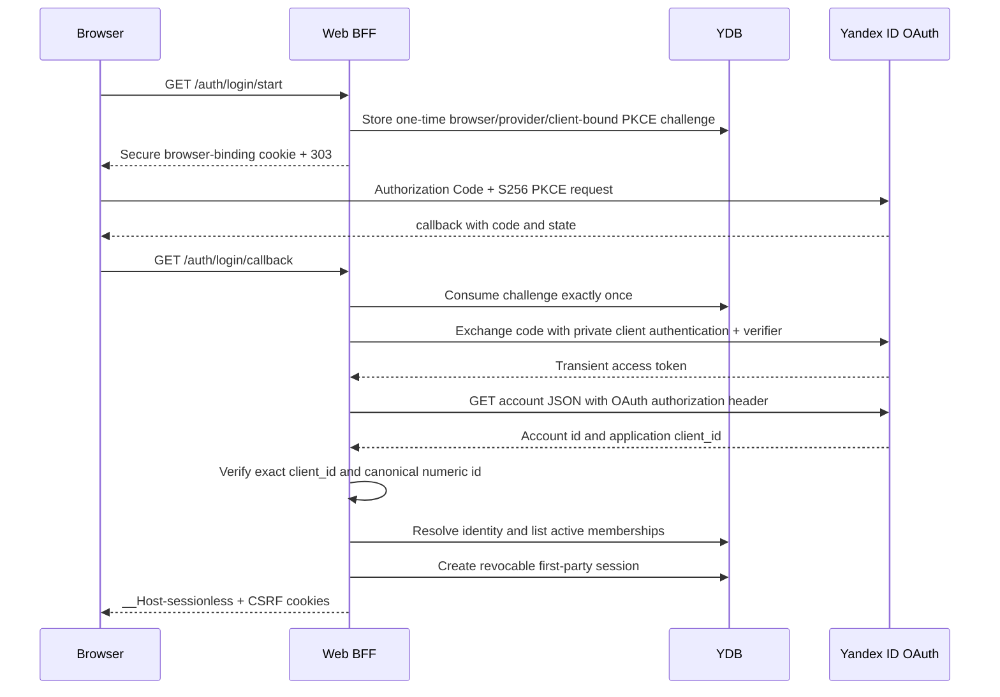

# Web BFF and provider-scoped login

## Boundary

`web-bff` is a same-origin Go backend-for-frontend. The selected Yandex OAuth or
legacy Telegram OIDC adapter proves an external identity; it does not grant
tenant access. Every authenticated
request is authorized against a current Sessionless tenant membership stored in
YDB. Browser-provided tenant IDs are selectors only.

The browser receives opaque first-party session and CSRF cookies. Provider
tokens, authorization codes, PKCE verifiers, OIDC nonces, and client secrets are
never returned to browser JavaScript or written to logs.



## HTTP routes

| Method | Route | Purpose |
| --- | --- | --- |
| `GET` | `/healthz`, `/readyz`, `/version` | Process health and build metadata |
| `GET` | `/auth/login/start` | Create a one-time login challenge for the deployment-selected provider |
| `GET` | `/auth/login/callback` | Consume the challenge, verify the selected identity, and create a membership-authorized Web session |
| `GET` | `/auth/telegram/start`, `/auth/telegram/callback` | Legacy aliases mounted only when Telegram is selected; existing Telegram callback registration is preserved |
| `POST` | `/auth/logout` | Revoke the current Web session |
| `GET` | `/api/web/v1/me` | Return the current identity and active tenant |
| `GET` | `/api/web/v1/tenants` | Return the caller's active memberships |
| `POST` | `/api/web/v1/active-tenant` | Rotate the Web session into another authorized tenant |
| `GET`, `POST` | `/api/web/v1/sessions` | Page active/archived sessions or create one idempotently |
| `GET` | `/api/web/v1/sessions/{session_id}` | Open bounded participant-authorized session metadata |
| `GET` | `/api/web/v1/sessions/{session_id}/events` | Page ordered canonical event payloads after authorization |
| `GET` | `/api/web/v1/sessions/{session_id}/runs` | Page provider/harness execution observations |
| `GET` | `/api/web/v1/sessions/{session_id}/compute` | Return participant-authorized safe compute/quota status |
| `POST` | `/api/web/v1/sessions/{session_id}/archive` | Archive or unarchive without deleting history |
| `POST` | `/api/web/v1/sessions/{session_id}/messages` | Append an idempotent canonical Web message and create its run |
| `POST` | `/api/web/v1/uploads` | Create an exact-object direct-upload capability |
| `POST` | `/api/web/v1/uploads/{upload_id}/commit` | Verify and commit the exact staged object |
| `GET` | `/api/web/v1/runs/{run_id}` | Read one participant-authorized run |
| `GET` | `/api/web/v1/attached-workers` | Page owner-scoped attached-worker summaries (`limit` 1–50, default 20) |
| `GET` | `/api/web/v1/attached-workers/{worker_id}` | Read the canonical owner-scoped attached-worker UX projection |
| `GET` | `/api/web/v1/attached-workers/{worker_id}/diagnostics` | Read bounded, redacted owner-scoped diagnostics |
| `POST` | `/api/web/v1/attached-workers/{worker_id}/actions:plan` | Seal a short-lived exact drain/revoke plan |
| `POST` | `/api/web/v1/attached-workers/{worker_id}/actions:apply` | Apply the exact confirmed plan idempotently |
| `GET` | `/api/web/v1/attached-worker-actions/{operation_id}` | Read the owner-scoped content-free operation receipt |
| `GET` | `/api/web/v1/sessions/{session_id}/events/{sequence}/attachments/{index}` | Create a short-lived capability for one canonical attachment |
| `GET` | `/api/web/v1/sessions/{session_id}/runs/{run_id}/artifact-manifests/{manifest_id}/artifacts/{index}` | Create a short-lived capability for one exact worker artifact |

Mutation routes require an exact `Origin` match and a double-submit CSRF value
whose digest must also match the current server-side session. Switching tenants
always revokes the previous session and rotates both opaque values. Cookies use
the `__Host-` prefix, `Secure`, `HttpOnly` where applicable, `Path=/`, and no
`Domain` attribute. The default idle lifetime is 12 hours and the absolute
lifetime is seven days.

Browser code cannot supply raw frontend coordinates. On message submission the
server creates or verifies the binding `(web, session_id)` for the authorized
canonical session. The generic revision-fenced binding operation remains an
internal adapter boundary and is deliberately not registered as a Web route.

Attached-worker read routes are projections of the AW-01–AW-05 authorities.
The path and pagination values are selectors, never tenant or
owner authority; the BFF always derives both from the authenticated Web
session. Missing and foreign-owner workers share the same public `not_found`
outcome. List queries accept only one optional `after_worker_id` and one
optional `limit`; detail and diagnostics reject query parameters. Encoded
responses are capped at 256 KiB, remain `Cache-Control: no-store`, and request
logs record the matched route template rather than the worker ID. These reads
do not refresh presence, evaluate admission, probe a daemon/provider, or mutate
attached-worker state. The separately mounted plan/apply routes admit only
`drain` and deny-first `revoke`. They require write membership, same-origin
double-submit CSRF, a fresh exact revision/generation plan, its deterministic
confirmation digest, and an idempotency key. Durable receipts report local
state while remote acknowledgement and remote erasure remain `unknown`; no
browser button is enabled by this backend slice.

Any failed login callback, including provider denial or missing enrollment,
redirects to the stable same-origin `/login?auth_error=access_denied` recovery
route and creates no Web session. Provider error names and descriptions are
never reflected into the URL or response body. Membership is created only by
an existing frontend participant, a validated invitation, or the audited
cloud-development bootstrap command.

If the callback failure cannot be durably audited, the login still fails
closed and clears the code/state-bearing callback URL through the stable
`/login?auth_error=temporarily_unavailable` recovery route. No provider or
audit-storage detail is reflected to the browser.

## Telegram provider configuration

This compatibility path remains the default when `WEB_LOGIN_PROVIDER` is empty
or `telegram`; the MVP independently selects `yandex`. The implementation
follows Telegram's OIDC Authorization Code flow with PKCE
`S256`. The production defaults are:

- issuer `https://oauth.telegram.org`;
- authorization endpoint `https://oauth.telegram.org/auth`;
- token endpoint `https://oauth.telegram.org/token`;
- JWKS endpoint `https://oauth.telegram.org/.well-known/jwks.json`;
- scopes `openid profile`;
- ID-token signing algorithm exactly `RS256`.

JWKS responses are size-bounded and cached for at most ten minutes. An unknown
key ID triggers one refresh before authentication fails closed. Token endpoint
responses and tokens never appear in errors. Provider endpoint overrides are
accepted only for loopback addresses in the local environment.

Source: [Telegram Login: OIDC integration](https://core.telegram.org/bots/telegram-login).

## Yandex provider configuration

`WEB_LOGIN_PROVIDER=yandex` selects Authorization Code OAuth with S256 PKCE.
Register exactly `WEB_BASE_URL` plus `/auth/login/callback` and request only
`login:info`. The pinned defaults are `https://oauth.yandex.ru/authorize`,
`https://oauth.yandex.ru/token` and `https://login.yandex.ru/info?format=json`.
The BFF privately authenticates its client for code exchange, retrieves account
JSON with the access token in the `Authorization: OAuth` header, and requires
the returned `client_id` to equal the configured application. Only the canonical
numeric account `id` becomes the `(yandex, id)` identity; email, login, display
name and the application-scoped `psuid` do not select a Sessionless user.
Access/refresh tokens are discarded after the callback and never persisted.

This path is not OIDC: it does not assume an ID token, JWKS or nonce. Its
single-use browser challenge is bound to Yandex and the configured application,
so a challenge issued for another provider/client cannot complete this login.
Missing selected credentials fail startup; there is no Telegram fallback.
Endpoint overrides are restricted to explicit loopback fixtures in `local`.

Sources: Yandex ID [code exchange](https://yandex.ru/dev/id/doc/ru/codes/code-url)
and [account information](https://yandex.ru/dev/id/doc/ru/user-information).

## Runtime configuration and secrets

| Variable | Meaning |
| --- | --- |
| `SESSIONLESS_ENVIRONMENT` | `local`, `cloud-dev`, or production environment name |
| `WEB_BASE_URL` | Exact public HTTPS origin; callback is derived from it |
| `WEB_PORT` | BFF listen port |
| `PORT` | Serverless platform listen port; takes precedence over `WEB_PORT` when set |
| `WEB_OBJECT_STORAGE_ORIGIN` | Exact browser-facing capability origin; required with the Web API, HTTPS except loopback HTTP in `local` |
| `WEB_LOGIN_PROVIDER` | `yandex` for the independent MVP path; empty or `telegram` preserves existing deployments |
| `YANDEX_LOGIN_CLIENT_ID` | Registered Yandex application client ID, required when selected |
| `YANDEX_LOGIN_CLIENT_SECRET` | Private Yandex client secret, required when selected |
| `YANDEX_LOGIN_AUTHORIZATION_ENDPOINT`, `YANDEX_LOGIN_TOKEN_ENDPOINT`, `YANDEX_LOGIN_INFO_ENDPOINT` | Optional local-loopback fixture overrides; public endpoints are pinned by default |
| `TELEGRAM_OIDC_ISSUER` | Expected ID-token issuer |
| `TELEGRAM_OIDC_AUTHORIZATION_ENDPOINT` | Telegram authorization endpoint |
| `TELEGRAM_OIDC_TOKEN_ENDPOINT` | Server-side token endpoint |
| `TELEGRAM_OIDC_JWKS_URL` | Signing-key endpoint |
| `TELEGRAM_OIDC_CLIENT_ID` | Telegram application client ID |
| `TELEGRAM_OIDC_CLIENT_SECRET` | Telegram application secret |
| `YDB_CONNECTION_STRING` | YDB endpoint/database coordinates only |
| `SESSION_API_CURSOR_HMAC_KEY` | At least 32 secret bytes for scoped opaque continuation tokens |
| `SESSION_API_ID_HMAC_KEY` | At least 32 secret bytes for deterministic session, upload, event, run, and dispatch IDs |
| `WEB_MAX_UPLOAD_BYTES` | Optional positive object limit; defaults to `33554432` (32 MiB) |
| `WEB_ALLOWED_MCP_SERVERS` | Optional comma-separated allowlist copied into Web-created jobs |
| `QUEUE_ENDPOINT`, `QUEUE_REGION` | Queue coordinates used to publish canonical scheduler wakes |
| `OUTBOX_QUEUE_ACCESS_KEY_ID`, `OUTBOX_QUEUE_SECRET_ACCESS_KEY` | Optional queue credentials; each falls back to its `QUEUE_*` counterpart locally |
| `SCHEDULER_WAKE_QUEUE_URL` | Scheduler-wake queue receiving durable ingress wake hints |
| `S3_ENDPOINT`, `S3_REGION`, `S3_BUCKET` | Exact Object Storage coordinates |
| `S3_ACCESS_KEY_ID`, `S3_SECRET_ACCESS_KEY`, `S3_FORCE_PATH_STYLE` | Static S3-compatible credentials and addressing, used by local MinIO |
| `S3_IAM_METADATA_CREDENTIALS` | Use the workload service-account IAM token for Yandex Object Storage and its Presign API |

The client secret must be injected into the process environment from an OS
secret store locally and Lockbox in Yandex Cloud. It must not be present in
Terraform state, container arguments, images, DSNs, repository files, or logs.
The existing Lockbox key `oidc-client-secret` remains a generic storage key for
the selected login secret: it maps to the Yandex or Telegram environment variable
according to the explicit deployment selector. This is not an OIDC assertion
about Yandex. The secret loader and Terraform must use the same provider.

`oidc-fake` is a Go-only local fixture. It uses the `OIDC_FIXTURE_*` variables,
generates one ephemeral RSA key per process, supports one-time authorization
codes, and refuses every environment except exact `local`. It is not built into
the production Web BFF image.

## Canonical message and object flow

The browser uploads large objects directly rather than proxying bytes through
the serverless BFF:

1. Create an upload intent with the target session, a fresh idempotency key,
   filename, allowed media type, byte count, lowercase SHA-256, and a canonical
   padded standard-base64 `content_md5` for the same bytes.
2. Use the returned `PUT` URL once, preserving every returned header exactly.
   The URL and headers, including `Content-MD5`, identify one server-generated
   staging object and expire quickly.
3. Commit the same `upload_id`. The BFF reauthorizes the user and verifies
   authoritative size, media type, checksum, key, and ETag from Object Storage.
4. Submit text and up to eight committed upload IDs to the session message
   route. The BFF resolves exactly one compute connection owned by the
   requesting user, promotes each unchanged object into the immutable event
   namespace, and atomically creates the canonical event/run.
5. Poll the returned run ID using `If-None-Match` and the server's
   `Retry-After`/`X-Sessionless-Poll-After-Ms` hints. Fetch new transcript
   events with `after_sequence`; do not combine it with `cursor`.

Before submission, the UI can read
`GET /api/web/v1/sessions/{session_id}/compute`. It returns `not_configured`,
`ready`, or `ambiguous`; only `ready` includes provider, entitlement, quota,
and observation time. Connection IDs, credential references, and tokens are
not part of the response.

Session/list/event/run reads return representation-derived ETags and answer a
matching `If-None-Match` with `304`. Attachment and worker-artifact routes
return a short-lived exact-object `GET` capability rather than an Object
Storage key. Worker-artifact lookup requires the participant-authorized exact
session/run/manifest relationship and a bounded index; assistant projections
publish only the opaque run and manifest selectors. All capability responses
remain `Cache-Control: no-store`; URLs must be redacted from request, audit,
and analytics logs and must not be persisted in browser storage.

The default accepted upload size is 32 MiB. The built-in safe media allowlist
is JSON, PDF, ZIP, GIF, JPEG, PNG, WebP, CSV, Markdown, and plain text. The
upload-intent lifetime is at most ten minutes, an upload capability at most
five minutes, and a download capability at most two minutes. Staging retention
is a storage lifecycle concern; an unclaimed staging object never becomes
canonical session history.

In Yandex workload-IAM mode the adapter authenticates with the service-account
IAM token and calls the official
[Object Storage `PresignService.Create`](https://yandex.cloud/en/docs/storage/api-ref/grpc/Presign/create)
endpoint at `storage.api.cloud.yandex.net:443`. Local static-key mode uses the
S3-compatible [pre-signed URL](https://yandex.cloud/en/docs/storage/concepts/pre-signed-urls)
contract through the AWS SDK.

## YDB data and access paths

| Table | Primary key | Hot-path access |
| --- | --- | --- |
| `external_identities` | `(shard_bucket, provider, subject)` | Point lookup from a verified provider-scoped account identity |
| `external_identities_by_user` | `(user_bucket, user_id, provider, subject)` | Bounded reverse lookup |
| `tenant_memberships` | `(user_bucket, user_id, tenant_id)` | Bounded user-prefix list or point membership check |
| `tenant_invitations` | `(tenant_id, invitation_id)` | Point consume with TTL |
| `oidc_login_challenges` | `(shard_bucket, state_digest)` | One-time browser/provider/client-bound challenge consume with TTL; legacy table name retained for OAuth too |
| `web_sessions` | `(shard_bucket, session_digest)` | Point authorize, rotate, and revoke with TTL |
| `web_security_audit_events` | `(shard_bucket, occurred_at, request_id)` | Durable login-failure and CSRF-rejection audit without requiring a resolved tenant |
| `development_bootstrap_grants` | `(tenant_id, user_id)` | Exact idempotency ledger for cloud-dev grants |
| `web_upload_intents` | `(tenant_id, upload_id)` | Point authorize, commit, and atomic bounded claim |
| `web_upload_intent_creations` | `(tenant_id, user_id, creation_idempotency_key)` | Exact upload-creation retry ledger |

The leading buckets are stable hashes of the point-lookup identity. They avoid
monotonic or attacker-selected hot prefixes while preserving deterministic
lookups. They are logical key distribution, not a manually managed physical
partition count: YDB automatic partitioning by size and load remains enabled on
all tables.

Telegram ingestion atomically materializes the same external-identity mapping
and owner membership used by the Web BFF. Therefore a user who already owns a
Telegram tenant can sign in through OIDC without a separate data copy or a
transport identifier becoming a product identity.
Yandex sign-in does not reuse that Telegram mapping merely because subject
strings or emails match. A new Yandex identity requires its own invitation or
audited bootstrap membership. Late linking two authenticated login methods to
one user is [post-MVP #172](https://gitcode.com/urandon/sessionless/issues/172),
not implicit inheritance and not a pilot release gate.

## Audited cloud-development bootstrap

Bootstrap is deliberately unavailable in production and never accepts secret
or authority-bearing command-line arguments. In the original mode, the external
identity must already exist. Set the target and operator metadata in the
environment, then type the
exact confirmation requested on standard input:

```sh
export SESSIONLESS_ENVIRONMENT=cloud-dev
export WEB_BOOTSTRAP_TENANT_ID=ten_example
export WEB_BOOTSTRAP_USER_ID=usr_example
export WEB_BOOTSTRAP_ROLE=owner
export WEB_BOOTSTRAP_OPERATOR=operator@example.com
export WEB_BOOTSTRAP_REASON='initial cloud-dev Web access'
export YDB_CONNECTION_STRING='grpcs://ydb.serverless.yandexcloud.net:2135/...'
make web-bootstrap
```

The command requires `BOOTSTRAP <user> INTO <tenant>` exactly. A successful
grant creates or verifies one membership and appends an audit event. Repeating
the exact grant is idempotent; changed role, operator, or reason is a conflict.

For explicit first-identity provisioning before the pilot's first sign-in, also
set `WEB_BOOTSTRAP_EXTERNAL_PROVIDER=yandex` and
`WEB_BOOTSTRAP_EXTERNAL_SUBJECT` to the operator-verified numeric Yandex account
`id`, not an email or username. Both optional variables are required together.
The confirmation is then exactly
`BOOTSTRAP <user> INTO <tenant> FOR yandex:<id>`. The existing identity resolver,
membership and audit commit in one transaction. A subject mapped to another
user or a target user with any different external identity is rejected without
a partial grant. This does not implement privileged account linking. Leave
both optional variables empty to retain the existing-identity mode.

## Exact-query search consent

The optional `SearchConsents` composition mounts a private GET/POST route at
`/api/web/v1/sessions/{session_id}/runs/{run_id}/attempts/{attempt_id}/search-consents/{request_id}`.
It is absent by default; defining this transport does not enable search or
supply an original worker, a model or a credential.
The owning implementation is [#195](https://gitcode.com/urandon/sessionless/issues/195).

GET accepts only the first-party cookie and path selectors, with no body or
query parameters. It does not use the generic Web authorization method that
refreshes idle activity. The existing consent Store derives the active tenant
from the cookie's current Web session, authenticates the initiating user and
participation before reading private material, and rechecks the same immutable
intent and all current authority after the body reads. Original argument size,
SHA and exact decoded-query digest must match. Grant and argument reads occur
outside SQL under the same ten-second, three-callback and four-MiB logical
budget; no helper resets it. The private response includes only request ID,
revision, status, original expiry and exact query, within eight KiB including
JSON escaping. It has no blob locator, claim, payer, grant or receipt metadata.

POST uses the existing cookie/header CSRF equality, exact Origin and mutation
audit rules. Only `expected_revision: 1` and explicit `approve`/`deny` are accepted;
unknown, duplicate, case-aliased fields and trailing JSON are rejected, with a
512-byte body ceiling. The original consent transaction revalidates stored
CSRF, actor and current claim/resource windows and owns immutable decision CAS.
The response is only a bounded state summary, never query text or a transferable
receipt. A user mutation can refresh Web-session idle activity under the normal
mutation contract; it cannot extend the consent, lease or execution deadline.
The logical request context is bounded to ten seconds; net/http ingress uses
the matching read deadline where supported, while unsupported wrappers retain
the Web server's existing fifteen-second body-read bound. No goroutine races an
arbitrary borrowed reader, and a late body cannot cause a decision.

Cookie-only discovery at
`GET /api/web/v1/sessions/{session_id}/runs/{run_id}/search-consents/current`
authenticates the current Web session, membership and Session participation,
then correlates the canonical Run and current Job/Attempt/source with the existing
bounded consent projection in one transaction. It returns only Session/Run and
an optional opaque Attempt/request selector and original expiry, within two KiB.
Explicit missing Job/parent/projection or no current pending request is
authenticated absence; malformed, foreign, revoked or failed reads remain errors.
Discovery never reads the grant/query body, refreshes idle activity or changes
state. Exact query disclosure still requires the separate private read above.

The optional browser build flag `VITE_SEARCH_CONSENT_ENABLED=true` adds a
canonical-Run review button to Session view; it defaults off and does not compose
the production BFF service or search producer. The nonmodal, keyboard-accessible
panel escapes exact query text without Markdown/links, requires explicit approve
or deny, and restores focus on close. Query and decision context stay in memory;
hide, unmount, identity/tenant/session/run change, permission loss and expiry
clear or fence obsolete reads and mutations. Closing does not undo a committed
decision. A failed POST remains unconfirmed: canonical readback may confirm it,
and only an explicit identical-choice retry can write again.

The browser has a nonrenewable 120-second Run review budget from first opening,
at most 24 polling rounds/48 total GETs (including discovery, exact reads and
lost-response recovery) and four explicit POST attempts. Reads are one-flight,
at least five seconds apart between rounds, each HTTP request bounded to ten
seconds. The current request's shorter expiry disables its decisions; a second
request can still be discovered inside the original Run review budget. A bounded
50-scope memory map preserves counters across close/reopen/scope switches and
fails closed at capacity rather than evicting and renewing them. Browser bounds
never replace server claim/grant/policy/lease/cost authority.

All responses are `no-store`, without ETags. Queries and private state never
enter route parameters, public Run explanations, request logs or public errors.
Approval is necessary but not sufficient for a search: the original operation
reserve and immediate before-send gate must independently revalidate the stored
receipt and all current authority. The complete feature additionally needs
bounded waiting in the original worker claim and genuine producer/runtime
composition. Fixture-only producer authority is not
an authentic model/search producer or permission to activate a profile.

## Verification

Credential-free unit tests cover the complete local authorization-code flow,
PKCE, one-time code use, Telegram RS256 verification, Yandex account/client
verification, membership denial, secure cookie
attributes, CSRF rejection, tenant rotation, old-session rejection, and logout.
YDB integration tests prove exactly one winner for concurrent challenge
consumption, stable external-identity resolution, tenant isolation, membership
security-version invalidation, and session rotation.

Run the repository-supported checks:

```sh
make test
make build
make ydb-integration
make web-auth-ydb-gate
```

`web-auth-ydb-gate` requires an already migrated test YDB and repeats
`TestYandexLoginYDBFreshIdentityMembershipIsolationReplayAndRevocation` and
`TestYandexBootstrapYDBAtomicFirstIdentityAndNoLink` with `-race -count=3
-shuffle=on` and a five-minute suite bound. It covers production YDB identity,
challenge, membership and session adapters against test-owned OAuth endpoints;
CI uses a fresh YDB fixture. Documented test coverage is not evidence that a
particular revision passed: record exact-head results before merge. A real
registered callback and deployed-platform reachability remain #34/#35 cloud
proof, not a claim made by synthetic tests.

Login failures and CSRF rejections are synchronously persisted to
`web_security_audit_events`; a failed audit write fails the request with
`503 temporarily_unavailable`. Pre-authentication events contain the provider
and, only after verification, a one-way external-subject fingerprint. They
never contain raw claims or browser credentials.

Request logs contain only request ID, method, path, and status. Query strings,
cookies, authorization codes, tokens, state, nonce, PKCE values, provider
response bodies, and raw security errors are excluded.

The session route authorization, pagination, consistency, bounded metadata,
and error contracts are specified in [session-api.md](session-api.md).
